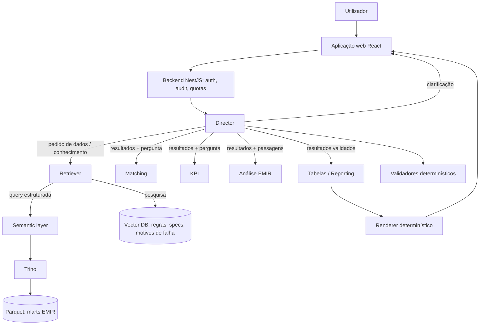

# Sistema multi-agente EMIR Matching

Primeiro caso de uso do Agentic RAG: um sistema multi-agente focado em EMIR, com ênfase no matching de reports de derivados. O utilizador escreve em linguagem natural na aplicação web e recebe KPIs de matching e tabelas.

Prompts: [`regdata-platform/prompts/emir-matching/`](../../regdata-platform/prompts/emir-matching/).

Estado: estrutura de agentes e fluxo definidos pelo Ordep (2026-10-13). Os ajustes da secção 2 e as definições de KPI da secção 7 são **propostas** a confirmar.

## 1. Requisitos (definidos pelo Ordep)

- Dados em Parquet; conhecimento indexado numa vector database.
- Interação por prompts em linguagem natural, numa aplicação web.
- Saída: KPIs de matching e tabelas.
- **Director (orquestrador):** conhece as regras de negócio EMIR e as regras internas; não faz RAG; percebe o pedido, verifica se está claro e completo, faz perguntas de clarificação, decompõe, escolhe agentes, agrega e valida, e só responde quando o resultado está correto e conforme as regras EMIR.
- **Agentes:** Retriever (único com acesso à vector database e aos dados), Matching, KPI, Análise EMIR, Tabelas/Reporting, Planeador (opcional).
- **Fluxo:** utilizador → frontend → Director → clarificação ou plano → agentes → Director valida → re-planeia se necessário → resposta final.

## 2. Ajustes necessários ao desenho (propostas)

### 2.1 A vector database não pode ser a fonte dos KPIs

Uma vector database devolve os *k* registos mais parecidos com a pergunta, não o conjunto completo. Uma taxa de matching calculada sobre o que a pesquisa vetorial devolve está errada por construção: faltam registos, e não há forma de saber quantos. Indexar milhões de linhas de trades como embeddings também é caro e expõe dados sem necessidade.

Proposta, mantendo o Retriever como **único** agente com acesso a dados:

| O Retriever precisa de | Usa | Devolve |
| --- | --- | --- |
| Factos numéricos (contagens, taxas, aging, listas de unmatched) | Query determinística à semantic layer → Trino → Parquet | Resultados completos e agregados, com `result_id` |
| Conhecimento (regras EMIR, regras internas, motivos de falha, specs) | Vector database (OpenSearch híbrido, `07-rag.md`) | Passagens com `doc_id`, secção, versão |
| Amostra de registos para ilustrar | Query determinística com limite | Linhas paginadas, com `result_id` |

### 2.2 O "conhecimento profundo" do Director vem de fora do modelo

O modelo não conhece as regras internas do banco e o seu conhecimento de EMIR pode estar desatualizado ou errado. O Director recebe no prompt de sistema um **resumo curado e versionado** das regras EMIR e internas relevantes para matching (gerado a partir do repositório de conhecimento), e pede ao Retriever o detalhe quando precisa. Não faz pesquisa diretamente, como pedido, mas também não responde de memória.

### 2.3 Nenhum LLM faz contas nem copia números

- O **KPI** escolhe métricas certificadas e monta o pedido; o cálculo é feito pela semantic layer.
- A **Tabelas** produz uma especificação da tabela (colunas, ordem, formato); um renderer determinístico preenche os valores a partir dos resultados. O LLM nunca reescreve números: é a fonte mais comum de erros em respostas com tabelas.
- A **validação** do Director combina validadores determinísticos (secção 6) com revisão do LLM.

### 2.4 Menos agentes LLM do que agentes no diagrama

| Agente | Tipo | Porquê |
| --- | --- | --- |
| Director | LLM (modelo forte) | Compreensão, planeamento, julgamento |
| Retriever | Executor determinístico + LLM pequeno só para reescrever pesquisas de conhecimento | Os pedidos de dados chegam já estruturados |
| Matching | LLM | Interpreta padrões de falha e aging sobre resultados agregados |
| KPI | LLM leve | Mapeia pedido → métricas certificadas; interpreta resultados |
| Análise EMIR | LLM (modelo forte) | Raciocínio regulatório com citações |
| Tabelas / Reporting | LLM leve + renderer determinístico | LLM decide a forma; código preenche os valores |
| Planeador | **Integrado no Director** | Um agente extra só acrescentava latência; separa-se se o plano ficar complexo |

Nenhum agente fala com outro diretamente: tudo passa pelo Director. Os especialistas nunca pedem dados ao Retriever; se lhes falta algo, devolvem `missing_data` e o Director decide.

## 3. Arquitetura



## 4. Fluxo (máquina de estados)

```
RECEBIDO
  → COMPREENDER        Director: intenção, âmbito, período, métricas, completude
  → CLARIFICAR?        se a ambiguidade muda o resultado: até 3 perguntas → espera pelo utilizador
  → PLANEAR            Director: passos, agentes, dependências, dados e conhecimento necessários
  → RECOLHER           Retriever: dados (semantic layer) e conhecimento (vector DB), em paralelo
  → ANALISAR           Matching, KPI, Análise EMIR (em paralelo quando independentes)
  → VALIDAR            validadores determinísticos + revisão do Director
        ├─ falha corrigível e replaneamentos < 2 → PLANEAR
        ├─ falta informação do utilizador → CLARIFICAR
        └─ falha no limite → RESPOSTA PARCIAL (o que se sabe + o que falta)
  → FORMATAR           Tabelas: especificação → renderer
  → RESPONDER          KPIs, tabelas, notas, evidência
```

**Limites por pedido:** 2 replaneamentos; 12 chamadas a agentes; 6 chamadas ao Retriever; orçamento de tokens; timeout. Ao atingir um limite, resposta parcial explícita, nunca uma resposta inventada.

**Quando o Director pergunta e quando assume:**

| Situação | Ação |
| --- | --- |
| Falta o período | Assume a última business date disponível e diz que assumiu |
| Métrica com definições alternativas (ex. denominador da taxa) | Usa a definição certificada; se não houver, pergunta |
| "Volume" sem indicação | Pergunta: número de contratos ou notional |
| Contraparte ou produto ambíguo | Pergunta, com as opções encontradas |
| Pedido fora do âmbito (outro regime, alteração de dados) | Recusa e explica |

## 5. Contratos entre agentes

Definidos em [`prompts/emir-matching/00-contratos.md`](../../regdata-platform/prompts/emir-matching/00-contratos.md). Princípios:

- Todas as mensagens são JSON validado por schema; resposta inválida conta como falha do agente.
- Pedidos de dados usam métricas, dimensões, filtros e período (como a spec de vista), nunca SQL.
- Cada resultado tem um id (`result_id`, `doc_id`); cada afirmação na resposta final aponta para ids.
- Estados de resultado: `ok`, `missing_data`, `out_of_scope`, `error`.

## 6. Validação antes de responder

Determinística (código, não LLM):

- Cada número da resposta final existe num resultado do Retriever.
- Coerência de totais no mesmo âmbito: matched + unmatched + unpaired = total.
- Soma das quebras (por contraparte, por tipo de derivado) = total, para métricas aditivas.
- Taxas entre 0 e 100% e recalculáveis a partir do numerador e denominador devolvidos.
- Unmatched > 10 dias ≤ unmatched > 5 dias ≤ total de unmatched.
- Aging ≥ 0.
- Todos os resultados com a mesma data de referência e o mesmo snapshot.

Revisão do Director (LLM):

- A resposta responde ao que foi perguntado, no âmbito e período pedidos.
- Afirmações regulatórias têm passagem citada e versão.
- Pressupostos assumidos estão explícitos.

## 7. KPIs de matching: definições a confirmar

Os nomes vêm do Ordep; as definições abaixo são **propostas**. Cada uma tem uma escolha que muda o número, por isso nenhuma pode ser usada antes de ser certificada.

| KPI | Definição proposta | Escolha a confirmar |
| --- | --- | --- |
| Taxa de matching | matched / contratos sujeitos a reconciliação | Denominador: todos, só os paired, ou só os reconciliáveis? |
| Número de unmatched | Contratos com estado unmatched na data de referência | Incluir unpaired? |
| Volume de unmatched | Soma do notional dos unmatched | Notional ou número? Moeda e conversão? |
| Aging médio | Média de dias desde o primeiro unmatched até à data de referência, só abertos | Dias corridos ou úteis? |
| Unmatched > 5 / > 10 dias | Unmatched com aging acima do limiar | Estritamente maior ou maior ou igual? |
| Taxa de matching por contraparte | Taxa de matching por contraparte | Mesmo denominador da taxa global |
| Taxa de matching por tipo de derivado | Taxa de matching por classe de ativo / tipo | Classificação usada no mart |
| Taxa de pairing failed | Unpaired / contratos sujeitos a reconciliação | Definição de pairing failed no mart |

## 8. Riscos

| Risco | Mitigação |
| --- | --- |
| KPIs calculados sobre retrieval vetorial | Dados só por query determinística (2.1) |
| Director responde de memória sobre regras | Resumo curado no prompt + citações obrigatórias (2.2) |
| Números alterados ao formatar | Renderer determinístico (2.3) |
| Conclusões de conformidade tratadas como parecer | A Análise EMIR produz indicações com citação, nunca pareceres; decisão é humana |
| Loops e custo | Limites por pedido (4) |
| Definições de KPI divergentes | Só métricas certificadas (7) |
| Prompt injection via campos de texto ou documentos | Conteúdo recuperado tratado como dado, nunca como instrução; agentes sem tools de escrita |

## 9. Questões abertas

Ver `04-questoes-abertas.md` (#19–#23).
