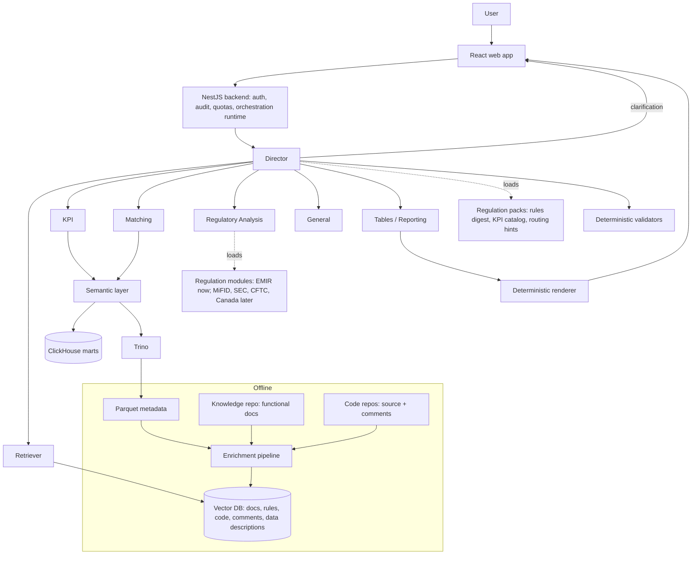

# Multi-regulatory Agentic RAG — architecture

Status: v2 (2026-10-13), defined by Ordep; supersedes the EMIR Matching v1 design. Items marked **proposal** are Claude's adjustments, pending Ordep's confirmation.

Prompts: [`regdata-platform/prompts/`](../../regdata-platform/prompts/). Language rules: section 11.

## 1. Scope

- Starts with **EMIR**: trade reporting, matching, clearing, risk mitigation, collateral, and several KPI categories.
- Extends later to **MiFID II/MiFIR, SEC, CFTC and Canadian** regulations, without redesign.
- Users ask questions in natural language through the web app.
- The RAG is enriched with business data from Parquet, functional documents, source code and code comments.

### "Any type of question" — the boundaries (proposal)

The system accepts any question, but answers it only from the right source:

| Question type | Answered by | Never |
| --- | --- | --- |
| Numbers, KPIs, tables | KPI / Matching agents via the analytical engines (ClickHouse or Parquet) | From the vector database or from model memory |
| Rules, processes, code, "how / why" | Retriever (vector database) + specialists | From model memory |
| Regulatory assessment | Regulatory Analysis agent, citing retrieved passages | As legal advice |
| Generic, non-regulatory | General agent, labelled as general knowledge | With internal facts it was not given |
| Data changes, resubmissions, actions on systems | Rejected | — |
| Nothing found | "No evidence available" is a valid answer | Filled with plausible text |

## 2. The two data sources

| | Vector database (OpenSearch, hybrid) | Analytical engines: ClickHouse **and** Parquet (via Trino) |
| --- | --- | --- |
| Purpose | Understand, find context | Calculate, aggregate |
| Content | Functional documents, business rules, regulation text, source code, code comments, **descriptions of the Parquet data** | Calculated data marts (row level, rules applied), stored either in ClickHouse or in Parquet |
| Accessed by | Retriever only | KPI and Matching agents only, **through the semantic layer** |
| Returns | Passages with `doc_id`, section, version | Complete results with `result_id`, `as_of`, `snapshot_id` |

**Rule:** the vector database never computes KPIs or numeric aggregations. A vector search returns the *k* most similar items, not the full set, so any count or rate computed from it is wrong by construction.

### Proposal: what "business data from Parquet" means in the vector database

Embed **metadata, not rows**:

- table and column descriptions (data dictionary);
- value domains of categorical columns (e.g. failure reason codes, statuses) with their meanings;
- relationships between marts, rules and KPIs;
- anonymised illustrative examples where useful.

Not embedded: individual trades, counterparties, amounts. They add cost and data exposure, and they would be useless for answers, because numbers come from ClickHouse.

### Calculated data lives in ClickHouse or in Parquet

Defined by Ordep (2026-10-13): a calculated mart can be stored in ClickHouse or in Parquet. The agents do not choose the engine and do not know which one answers:

- each mart declares its engine in the pack's `marts.yaml` (`engine: clickhouse | parquet`);
- the semantic layer routes each query to that engine (ClickHouse directly; Parquet via Trino);
- every result carries `engine`, `as_of` and `snapshot_id`.

Rules (proposal):

| Rule | Why |
| --- | --- |
| **Parquet is the authoritative copy** (decided by Ordep, 2026-10-13). When a mart also exists in ClickHouse, the ClickHouse copy is a derived, faster copy and declares its freshness in `marts.yaml` | Two copies drift; the answer must say which one it used |
| If the ClickHouse copy is behind the requested `as_of`, the semantic layer reads Parquet instead | The number must never depend on which copy happened to answer |
| No joins across engines in a single query | Federated joins are slow and hard to reason about; combine results only in the semantic layer, by separate queries on the same snapshot date |
| Results from different engines in one answer must share `as_of`; the validator checks it | Avoids mixing yesterday's ClickHouse copy with today's Parquet |
| Interactive pivots prefer ClickHouse; scheduled reports can use either | Latency (ADR-001) |

### Proposal: KPI and Matching agents query the analytical engines through typed tools, never with LLM-written SQL

| Tool | Does |
| --- | --- |
| `metrics.query` | Certified metrics × dimensions × filters × period → semantic layer → SQL generated by the semantic layer → ClickHouse or Trino/Parquet, per mart |
| `metrics.describe` | Definition, version, numerator/denominator, owner of a metric |
| `records.sample` | Limited, paginated rows for illustration (max 50) |
| `matching.breakdown` | Parameterised template: unmatched/unpaired by reason, field in break, aging bucket |

All tools run on behalf of the user (row-level security by regulation, entity), log to the audit trail and enforce limits. ClickHouse vs Parquet is a per-mart setting in the semantic layer (ADR-001); agents do not see the difference.

## 3. Agents

| Agent | Type | Data access | Role |
| --- | --- | --- | --- |
| **Director** | LLM, strong | None | Understand, classify, clarify, plan, delegate, validate, answer |
| **Retriever** | Deterministic search + small LLM for query rewriting | Vector DB | Context: rules, documents, code, comments, data descriptions |
| **KPI** | LLM, light | ClickHouse / Parquet via tools | KPIs of any category, exact numbers |
| **Matching** | LLM, medium | ClickHouse / Parquet via tools | Matched/unmatched, pairing failures, root causes, aging |
| **Regulatory Analysis** | LLM, strong + regulation modules | None (receives passages) | Obligations per regulation, with citations |
| **Tables / Reporting** | LLM, light + deterministic renderer | None | Table and KPI-card specifications; code fills the values |
| **General / Reasoning** | LLM | None | Generic, non-regulatory questions |
| **Enrichment** | Offline pipeline + LLM | Writes to vector DB via pipeline | Prepare documents, code and comments for indexing (section 9) |

**Proposals:**
- **Enrichment is not called from the chat.** It runs offline (Airflow, on every merge in the knowledge and code repositories), with human review where it creates knowledge. The Director can only report its status.
- **Planner is part of the Director.** A separate planner adds latency without value at this stage.
- **No LLM writes numbers.** Text uses placeholders `{{result_id:row:column}}`, replaced by the backend; tables are specs filled by a renderer.

### Rollout phases (proposal)

Building all agents before a single KPI is certified risks months of orchestration work with no user value. Proposed order:

| Phase | Agents | Delivers | Gate to next phase |
| --- | --- | --- | --- |
| 1 | Director, Retriever, KPI, Tables (+ Enrichment offline) | EMIR matching KPIs and tables by prompt; "what does X mean" answers | Certified KPI definitions (#19); golden set passing |
| 2 | + Matching | Root-cause analysis of unmatched/unpaired, aging | Matching mart documented (#20) |
| 3 | + Regulatory Analysis | Obligation-level indications with citations | Rules digest and regulatory sources indexed (#21, #22, #24) |
| 4 | + second regulation pack | Template extracted from EMIR; MiFIR/CFTC/SEC/CA added as packs | EMIR stable in production |
| Optional | General | Separate agent only if the Director's handling of generic questions is not enough | — |

"Multi-regulatory from day one" applies to the **structure** (regulation ids in contracts, packs, namespaced KPIs), not to building every module now. The generic template is extracted after the second regulation, when the real differences are known.

## 4. Architecture



## 5. How the Director communicates with the agents

The Director never calls agents directly. It emits **structured decisions**; the **orchestration runtime** in the NestJS backend executes them.

1. **Director → runtime:** `DirectorDecision` (JSON): `clarify`, `plan`, `respond` or `reject`.
2. **Runtime executes the plan:** runs steps in dependency order and in parallel when independent; injects the outputs of earlier steps into later ones; enforces ACL, limits and timeouts; stores every output in the run state with an id.
3. **Agents → runtime:** each returns an `AgentResult` (JSON, schema-validated). An invalid response counts as an agent failure.
4. **Validators run** on the collected results (section 7).
5. **Runtime → Director:** run state + validator report. The Director then responds, re-plans (max 2 times) or asks the user.
6. **Agents never talk to each other.** A specialist that needs more returns `needs` (data or context requests); the Director decides.
7. **Progress is streamed to the frontend** ("calculating matching rate…"), so the user sees what is happening.

Contracts: [`prompts/contracts.md`](../../regdata-platform/prompts/contracts.md).

Limits per request (proposal): 2 re-plans, 12 agent calls, 6 data queries, token budget, timeout. When a limit is reached, the answer is partial and says what is missing.

### Request routing

The Director classifies every request on two axes:

| Axis | Values |
| --- | --- |
| Regulation | `EMIR` (now), `MIFIR`, `SEC`, `CFTC`, `CA` (future), `CROSS`, `NONE` |
| Request type | `context`, `calculation`, `mixed`, `regulatory_assessment`, `general`, `out_of_scope` |

| Type | Agents |
| --- | --- |
| `context` | Retriever (+ Regulatory Analysis if an obligation is involved) |
| `calculation` | KPI and/or Matching → Tables |
| `mixed` | Retriever + KPI/Matching in parallel → specialists → Tables |
| `regulatory_assessment` | Retriever (passages) + KPI/Matching (facts) → Regulatory Analysis |
| `general` | General |
| `out_of_scope` | Reject with reason |

A regulation without an active pack is answered as "not yet supported", never improvised.

## 6. Clarify or assume

| Situation | Action |
| --- | --- |
| Period missing | Assume the latest available business date; state it |
| Regulation not stated, unambiguous from context | Assume; state it |
| "Volume": count or notional | Ask |
| Metric with no certified definition and several readings | Ask |
| Ambiguous counterparty, product or entity | Ask, listing the options found |

At most 3 questions, in one turn.

## 7. Validation before answering

Deterministic (code):
- every number in the answer resolves to a result;
- matched + unmatched + unpaired = total in the same scope;
- breakdowns sum to totals for additive metrics;
- rates in [0, 100] and recomputable from numerator and denominator;
- aging thresholds nested (> 10 days ≤ > 5 days ≤ total unmatched); aging ≥ 0;
- same `as_of` across results, also when they come from different engines (ClickHouse and Parquet).

Director review (LLM):
- answers the question asked, in the requested scope and period;
- regulatory statements cite a retrieved passage with version;
- assumptions are explicit; general-knowledge content is labelled as such.

## 8. Organising regulatory knowledge and KPIs for extensibility

### Regulation packs

Each regulation is a **pack**: a folder in the knowledge repository with a manifest. The agents stay generic; the pack supplies the regulation-specific knowledge. Adding MiFIR or CFTC means adding a pack, not changing agents.

```
knowledge/
  regulations/
    emir/
      pack.yaml              # id, name, version, topics, owners, status (active | draft)
      digest.md              # curated rules digest for the Director (PT)
      analysis-module.md     # Regulatory Analysis module: topics, checks, severity rules (PT)
      routing.md             # vocabulary and hints for the Director (synonyms, typical questions)
      kpis/                  # metric definitions per category (YAML)
        matching/  reporting/  clearing/  collateral/  risk-mitigation/  data-quality/  operational/
      marts.yaml             # marts used, engine (clickhouse | parquet), authoritative copy, semantic layer cubes
      glossary.md
      golden-set/            # evaluation questions with validated answers
      sources/               # regulation text and internal rules, converted to Markdown
    mifir/   sec/   cftc/   canada/   # same structure, added later
  shared/
    kpis/                    # cross-regulation metrics (e.g. data-quality completeness)
    glossary.md
```

Example `pack.yaml` (fictitious):

```yaml
id: emir
name: EMIR (REFIT)
status: active
version: 2026.10.0
topics: [trade_reporting, matching, clearing, risk_mitigation, collateral, data_quality]
kpi_categories: [matching, reporting, clearing, collateral, risk_mitigation, data_quality, operational]
digest: digest.md
analysis_module: analysis-module.md
owners: [regulatory-data-emir]
```

### KPI definitions

One YAML per metric, namespaced by regulation and category, loaded into the semantic layer and into the catalog the agents see:

```yaml
id: emir.matching.matching_rate        # fictitious example
label: Taxa de matching
category: matching
regulation: emir
type: ratio                            # count | sum | ratio | average | distribution
numerator: emir.matching.matched_count
denominator: emir.matching.reconcilable_count
dimensions: [business_date, counterparty_group, derivative_type, legal_entity]
status: draft                          # draft | certified | deprecated
version: 0.1
owner: regulatory-data-emir
definition_notes: Denominator to be confirmed (open question #19)
```

Rules:
- Ratios always declare numerator and denominator, so they are verifiable and aggregate correctly.
- A metric shared across regulations lives in `shared/`; a regulation overrides it only with a new id.
- The Director and the agents only see `certified` metrics by default; `draft` only with an explicit warning.

## 9. Enrichment pipeline

Offline, triggered on merge in the knowledge repository and in the code repositories, and on schema changes in the marts.

```
detect change → extract → classify → validate language & sensitivity → chunk → enrich (LLM) → human review (where required) → embed → index (versioned) → evaluate → publish → change_event
```

| Step | Functional documents (PT) | Source code + comments (EN) | Parquet metadata |
| --- | --- | --- | --- |
| Source | Markdown with front matter in the knowledge repo (`07-rag.md` §6) | Git repos (PySpark, SQL, TypeScript) | Mart schemas + data dictionary |
| Extract | Sections by heading; tables kept whole | AST: modules, classes, functions; docstrings and comments attached to their code | Tables, columns, types, value domains |
| Language check | Portuguese allowed | Code and comments must be English: non-English comments are **flagged in the code repo's CI**, not silently translated | English or Portuguese descriptions |
| Chunk | Section | Function / class, with its comments and signature | Table, column group |
| LLM enrichment | Summary in **English** (cross-lingual retrieval); entities (fields, rule ids, KPI names) | Summary in **Portuguese** (cross-lingual retrieval); proposed rule card | Column meaning summaries |
| Human review | Not needed for summaries (sampled QA); needed for anything that becomes a rule or KPI | **Rule cards require review** before becoming official | Data dictionary owner reviews |
| Metadata | regulation, topic, doc_type, language, version, effective dates, owner, ACL, links | repo, path, symbol, commit, language, links to rules/marts | mart, column, version |
| Sensitivity | Scan for personal or client data: block | Scan for secrets and credentials: block | No row values |

Cross-lingual retrieval:
- multilingual embedding model;
- each chunk carries a summary in the other language;
- the Retriever generates queries in both Portuguese and English (lexical search does not cross languages).

Index publication:
- build a new index version, run retrieval checks against the golden queries, then switch an alias (blue/green); roll back by switching back;
- every published change emits a `change_event`, so "what changed in rule X since June?" is answerable.

## 10. Risks

| Risk | Mitigation |
| --- | --- |
| KPIs computed from vector search | Hard separation: only KPI/Matching compute, only via the analytical engine tools |
| Same mart in ClickHouse and Parquet with different numbers | One authoritative engine per mart; `engine` and `as_of` in every result; validator checks consistency |
| LLM-written SQL returns plausible wrong numbers | Semantic layer and templates; no free SQL in the main path |
| Director answers regulatory content from memory | Curated digest + citations required + validator |
| "Any question" turns into unsupported claims | Routing table (section 1), General agent labelled, "no evidence" allowed |
| New regulation added by editing prompts | Regulation packs; agents stay generic |
| Mixed-language knowledge not found | Bilingual summaries + bilingual queries + multilingual embeddings |
| Enrichment indexes sensitive data | Sensitivity scan blocks; no Parquet rows embedded |
| Prompt injection through documents or code comments | Retrieved content is data, never instructions; agents have no write tools |

## 11. Language rules (defined by Ordep)

| Artifact | Language |
| --- | --- |
| Source code and code comments | English (mandatory) |
| Functional documents, business rules, agent prompts | Portuguese allowed |
| Architecture descriptions, technical explanations | English allowed |
| Answers to users | The user's language |

## 12. Open questions

See `04-questoes-abertas.md` (#19–#26).
